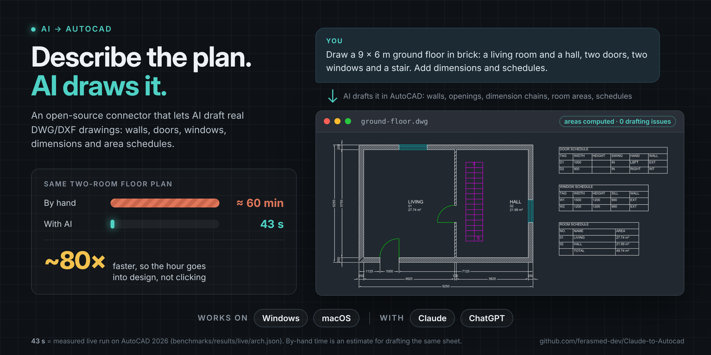

# Autocad connector to Claude

<p align="center"></p>

## How to install

Just text me on Instagram, [@feras.elhs](https://www.instagram.com/feras.elhs/), and I'll help you set it up.

### OR set it up yourself

It takes about 5 minutes and works on **Windows** and **macOS**. On Windows, AutoCAD can be drawn in live while it is open. On macOS, the drawings are saved as DXF files that you open in AutoCAD for Mac. Pick the app you use:

<details>
<summary><b>Claude Desktop app</b></summary>

<br>

You need the [Claude Desktop](https://claude.ai/download) app.

**1. Install uv** (it downloads and runs the connector for you).

On Windows, open **PowerShell** and run:

```powershell
powershell -ExecutionPolicy ByPass -c "irm https://astral.sh/uv/install.ps1 | iex"
```

On macOS, open **Terminal** and run:

```bash
curl -LsSf https://astral.sh/uv/install.sh | sh
```

**2. Open the Claude Desktop config.** In Claude Desktop, go to **Settings → Developer → Edit Config**. This opens a file called `claude_desktop_config.json`.

**3. Paste this into the file** and save it. If the file already has an `"mcpServers"` section, add only the `"autocad"` part inside it.

```json
{
  "mcpServers": {
    "autocad": {
      "command": "uvx",
      "args": [
        "--from",
        "autocad-mcp-pro[com,pdf,office] @ git+https://github.com/ferasmed-dev/AI-to-Autocad",
        "autocad-mcp"
      ],
      "env": {
        "AUTOCAD_MCP_BACKEND": "auto"
      }
    }
  }
}
```

**4. Restart Claude Desktop** (quit it fully, then open it again). On Windows, open AutoCAD first if you want Claude to draw in it live.

**5. Try it.** Ask Claude something like:

> Draw a 9 × 6 m ground floor in brick: a living room and a hall, two doors, two windows and a stair. Add dimensions and schedules, and save it to my Documents folder.

If Claude says it can't find `uvx`, replace `"uvx"` in step 3 with its full path: `C:\Users\YOUR-NAME\.local\bin\uvx.exe` on Windows, or `/Users/YOUR-NAME/.local/bin/uvx` on macOS.

</details>

<details>
<summary><b>Claude Code plugin</b></summary>

<br>

The plugin installs the connector and the premium drafting skill together. The skill teaches Claude the careful workflow: requirements → geometry → checked on the drawing → saved → reopened → delivered.

**1. Install uv** if you don't have it yet (same commands as in the Claude Desktop steps: PowerShell on Windows, Terminal on macOS).

**2. Add the plugin.** In a terminal, run:

```bash
claude plugin marketplace add ferasmed-dev/AI-to-Autocad
claude plugin install autocad-mcp-pro@autocad-mcp
```

**3. Restart Claude Code** and ask it to draw something, for example a 9 × 6 m ground floor with a living room, a hall, dimensions and schedules. On Windows, open AutoCAD first if you want Claude to draw in it live.

Already added the connector to Claude Code another way? Keep only one: turn the plugin's `autocad` server off in `/mcp`, or copy `.claude/skills/autocad-mcp-premium/` into your own `.claude/skills/` instead of installing the plugin. [`plugin/README.md`](plugin/README.md) has the details.

</details>

## What you get

| Area | What it does |
|---|---|
| Drawing lifecycle | create, open, save, export DXF/PDF, audit *(repairs)*, purge, undo/redo |
| Geometry | lines, arcs, polylines, splines, hatches, trim/extend/fillet/chamfer, handle-preserving edits |
| Annotation | ISO 129 toleranced dimensions, ISO 286 fits (`fit="H7"`, interference shafts r/s/t/u included), TABLE, MLEADER, GD&T frames and datums (ISO 1101) |
| Engineering generators | involute gears (front + section A-A), DIN 6885 keyed bores, ISO A3 title block |
| Mechanical parts | one part model (segments or outline + typed features) and one view engine: front / side / top / section / detail with hidden lines, ISO 128-50 cut faces and ISO 129 dimensions. ISO 4014/4017/4032/7089/4762 fasteners and ISO 15 bearings insert as real blocks with attributes. DIN 471/472, DIN 509, DIN 332 and ISO 3601-2 features have their drawing code, but *their tables still ship empty in 1.7* (see [limits](https://github.com/U-C4N/Autocad-MCP#what-this-release-is-bad-at)). Also ISO 21920-1 surface texture, ISO 2553 welds and ISO 128-40 section lines |
| Sheet & delivery | ISO 5457 frames A4-A0 with zones and trim marks, ISO 7200 title blocks for every size, revision blocks with clouds, ISO 7573 parts lists with ISO 6433 balloons linked by XDATA, CSV/XLSX extraction, xrefs and images on both engines, real `.dwg` on a live seat |
| Architecture | one plan model (walls with hosted doors and windows) and one engine that resolves L / T / X junctions, cuts openings and draws poché by material. Room areas are measured from the faces the walls enclose, never typed, and rooms are read back from any plan with a confidence. Door / window / room schedules are real TABLEs. Also a furniture and sanitary catalogue at nominal sizes, a structural grid, north arrow, section / level / elevation marks, exterior dimension chains, and English or Turkish labels (`lang="tr"`, decimal comma) |
| Understanding & takeoffs | `drawing_understand` reads a drawing somebody else made in one call: declared vs inferred units, robust extents and the outlier behind them, plan copies, each layer's discipline and service in five languages, tags, rooms. `drawing_scale_check` says whether a P&ID is to scale against its layout. `pipe_takeoff` / `cable_takeoff` take the topology from the P&ID and the lengths from the layout (rectilinear MST, statuses A/B/C, power never invented) into a Turkish / English / Russian workbook. `drawing_diff` compares revisions; `drawing_topology_check` finds dangling ends, near misses and crossings |
| P&ID | catalogue blocks with ports and tags (ISO 10628-2 / ISA-5.1), port-to-port lines with ISA-5.1 classes and line numbers, `pid_graph` reads any P&ID back with confidence, instrument index / line list / equipment list, `pid_from_spec` one-call sheets |
| Styles & standards | ISO-25 / ANSI dimension styles, ISOCP / ROMANS text styles, ISO / ANSI leader styles from authored presets; `drawing_apply_standard("iso")` sets all of it plus units and the `mech` layers in one call; `changed` reports only what moved |
| Discovery | `search_tools` ranked over an AutoCAD command and synonym corpus — `FILLET`, `BPOLY`, `QSELECT`, `WBLOCK`, `OVERKILL`, `CHSPACE` each rank **#1** of the 243-tool advertised catalog; `describe_tool` returns one hit's full input schema, risk, pack and its docstring's own examples |
| Batching | `cad_batch` runs a step list in one round trip; `fields=` projects 11 result-heavy tools |
| Paper space | tab lifecycle, viewports, `entity_change_space` (CHSPACE), `drawing_export_pdf(layout=…)` |
| Page setup & templates | ISO 216 / ANSI Y14.1 sheets, ctb catalog, `page_setup_apply` on both engines, and `batch_plot` with every sheet size read back from its PDF's `/MediaBox`. Five bundled templates, built by the server's own tools and pinned reproducible: `drawing_new(template="iso_a3_mech")`, `iso_a1_arch`, `iso_a3_pid`, `ansi_b_mech`, `ansi_d_arch`. Save any drawing as a template (`.dwt` on live AutoCAD; `dwt_write` refused headlessly) |
| Environment | several open documents headlessly, portable layer states (`ACADMCP_LAYERSTATES` XRECORDs — in the file, not in AutoCAD's Layer States Manager), named views, UCS *(tool coordinates stay WCS)*, a system-variable catalog with ranges, document properties. On a live seat: launch/attach, preferences, and an operator prompt / pick / select, where ESC is `cancelled`, not an error |
| Selection | window vs crossing stated back to the caller; a polygon tested against its own shape, not its bounding box |
| Boundaries | `boundary_trace` (BOUNDARY/BPOLY) chains loose edges into one closed polyline, arcs kept as bulges *(headless)* |
| Measurement | `analysis_measure_entity` measures what is *in* the drawing, by handle |
| Hatch depth | gradients, in-place edits, typed edge boundaries *(headless)*, island styles |
| Annotation objects | WIPEOUT, REVCLOUD, MTEXT background masks *(headless)*, text find/replace |
| 3D solids | `solid_box/cylinder/extrude/revolve/boolean` on live AutoCAD (`ENABLE_3D=true`) |
| Quality loop | `drawing_preflight` → `drawing_plan` → `drawing_critique` → `drawing_refine` → `drawing_finalize` (0–100 score); 18 domain critique focuses (P&ID 6, mechanical 6, architecture 3, topology 3), each silent on a drawing outside its domain. Every check reads every entity of every space, and a check that fails says so |
| Verification | `drawing_verify_requirements` binds typed source requirements to the real features (handle, feature tag, geometry or DIMENSION) and measures them on the drawing or on a saved file: distance, radius, diameter, angle, concentric, parallel, perpendicular, tangent, counts and absence, each **pass / fail / unknown / unsupported / ambiguous** with its evidence, as JSON or Markdown. The set can be stored in the drawing itself |
| Delivery | `drawing_deliver`: DXF/PDF/PNG + SHA-256 manifest, reopen parity against a second export over every space and block definition (its `scope` says what that can and cannot see), and with `requirements=` every requirement measured again on the reopened file; the open document is never re-pointed at the export |
| Safe edits | documents carry an id and a content revision; `cad_batch` / `drawing_refine` / `text_find_replace` / `pid_from_spec` preview exactly and apply only against an unchanged revision; a client operation id replays a retried call instead of repeating it |

<sub>248 tools in 28 groups. <code>TOOL_PACKS=core</code> hides these from a client that needs none of them: the nine <code>pid_*</code> tools, the 22 environment tools, the 14 mechanical tools, the 12 architectural tools and the two plant takeoffs. <code>TOOL_PACKS=core,mech</code> keeps the mechanical ones, <code>TOOL_PACKS=core,arch</code> the architectural ones, and <code>TOOL_PACKS=core,plant</code> the takeoffs. There are also 11 resources that cost nothing in the tool budget (<code>autocad://drawing/info</code>, <code>layers</code>, <code>blocks</code>, <code>entities/stats</code>, <code>entities/{layer_name}</code>, <code>system/status</code>, <code>pid/symbols</code>, <code>standards/isa51</code>, <code>standards/coverage</code>, and the task recipes <code>recipes/index</code> and <code>recipes/{recipe_id}</code>) and 5 prompt templates.</sub>

**Two rules worth knowing.**

- Every coordinate in and out of a tool is WCS on both engines. The one exception is TEXT `rotation`, which stays in the entity frame: a mirrored TEXT is mirror-imaged, and no scalar angle expresses that.
- Never read vertices back and shoelace them. That silently loses **28.2%** of the area on a semicircular edge. `analysis_measure_entity(handle)` reads the real geometry and states its own accuracy.

## Why this exists

**A big MCP server is expensive to be connected to.** The full catalog costs a client **89,226 tokens** before it has asked for anything. Discovery mode replaces it with three tools and costs **503**.

**A drafter searches for `FILLET`, not `entity_fillet`.** Before the corpus, those command names appeared in no tool name or description. That was `df = 0` against a stock index: the tools were not ranked badly, they were *absent*. The fix was data: an authored corpus of **206 AutoCAD command names and 1459 synonym phrases** covering all 248 tools. A test refuses to let a tool exist without one.

| Advertised surface | Tools seen | Idle cost |
|---|---:|---:|
| `TOOL_PROFILE=full` (default) | 243 | 89,226 tokens |
| `TOOL_PACKS=core,mech` (full profile) | 198 | 69,266 tokens |
| `TOOL_PACKS=core,settings` (full profile) | 206 | 68,221 tokens |
| `TOOL_PACKS=core,arch` (full profile) | 196 | 67,849 tokens |
| `TOOL_PACKS=core,pid` (full profile) | 193 | 65,987 tokens |
| `TOOL_PACKS=core,plant` (full profile) | 186 | 63,589 tokens |
| `TOOL_PACKS=core` (full profile) | 184 | 61,422 tokens |
| `TOOL_PROFILE=lean` | 66 | 25,066 tokens |
| `DISCOVERY_MODE=search` | 3 | **503 tokens** |

> [!NOTE]
> Re-measured for 1.7.0 with `benchmarks/token_suite.py`'s idle lane, over the real in-memory server. These are offline ratio estimates, not tokenizer counts, and they are the *uncached* cost: prompt caching amortises the idle term. 1.7 made the default surface 5,305 tokens dearer than 1.6.0 (lean 2,405): one more tool, plus the revision, preview and requirement parameters added to existing ones. `benchmarks/token_suite.py --tokenizer anthropic` counts for real.

## Credits

Republished by [ferasmed-dev](https://github.com/ferasmed-dev).
Based on [U-C4N/Autocad-MCP](https://github.com/U-C4N/Autocad-MCP) by Umutcan Edizsalan,
used under the MIT License (see [LICENSE](LICENSE)). All original code and credit belong to the original author.
